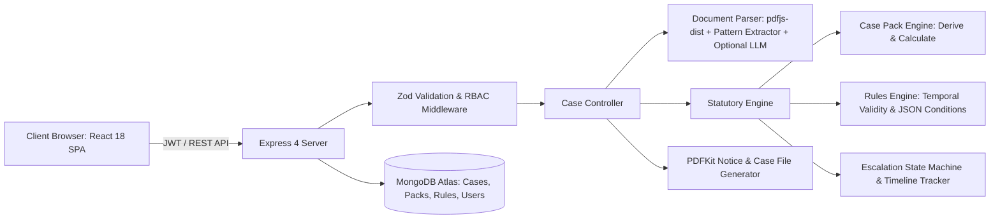

# SettleWise

**Turn statutory rights into calculated recovery.** SettleWise parses agreements, tickets, and dispute documents, validates them against applicable statutory provisions, computes accurate claim amounts with full step-by-step working, drafts formal legal notice letters, and tracks escalation timelines through statutory authorities and government dispute portals.

- **Frontend:** React 18, Vite, Tailwind CSS, Framer Motion, Lenis, Three.js
- **API:** Node.js 22, Express, MongoDB Atlas, Mongoose, Zod, PDFKit
- **Design System:** Obsidian Emerald & Champagne Gold (deep obsidian charcoal/emerald dark canvas, emerald-to-teal gradients, warm gold accents)
- **Deployment:** Vercel Multi-Services Architecture (`settlewise-api` + `client`) or Render
- **Sample documents:** [`demo-documents/`](demo-documents/) contains illustrative test documents across all supported case categories.

Built by **SNEHIL** — Full-Stack MERN Platform.

---

## Overview & Problem Statement

Individuals in India frequently forfeit legitimate financial dues when dealing with employers, commercial airlines, or landlords, despite clear statutory and contractual backing:

- **Employment exits & final settlement (FnF):** Following resignation or separation, final settlements are routinely delayed, gratuity is excluded, or excessive notice pay is deducted. Under statutory provisions (including Code on Wages provisions effective 21 November 2025), final dues are payable within **two working days**, and fixed-term employees qualify for gratuity after one year.
- **Flight disruption & cancellation:** Airlines frequently cancel or substantially delay scheduled flights and offer only base fare refunds or flight credit, despite DGCA CAR (Civil Aviation Requirements, Section 3, Series M, Part IV) mandating compensation of up to ₹10,000 in addition to complete refunds.
- **Rental deposit withholding:** Landlords frequently withhold security deposits citing arbitrary "repainting" or unsubstantiated wear-and-tear damages without contractual basis or verified bills.

Aggrieved claimants often lack the precise statutory sections, mathematical workings, and formal escalations required to secure compliance. **SettleWise** automates this entire pipeline.

---

## Core Architecture & Workflow

SettleWise operates on an untrusted AI / deterministic verification paradigm:



### Deterministic Rules & Verification Engine
1. **Fact Confirmation:** Document text extracted from PDFs or user input is validated and confirmed by the claimant.
2. **Statutory Rules Assessment:** Stored rule trees with statutory citations (Code on Wages, Industrial Disputes, DGCA CAR, Model Tenancy Act, Indian Contract Act) evaluate verified facts.
3. **Transparent Line-by-Line Calculation:** Generates an exact "Entitled vs Offered" shortfall ledger with statutory justification for every line item.
4. **Actionable Deliverables:**
   - Formal notice letters generated via PDFKit ready for email or registered post.
   - Government portal filing packs (SAMADHAN for labour disputes, AirSewa for civil aviation, e-Jagriti for Consumer Commissions).
   - Automated timeline & countdown tracker for reply deadlines and stage escalations.
   - Complete unified Case File PDF compilation with correspondence logs.

---

## Supported Case Categories

| Case Pack | Applicable Laws & Guidelines | Escalation Hierarchy |
|---|---|---|
| **Employment & Final Settlement** | Code on Wages 2019 s.17(2), Code on Social Security 2020 s.53, Indian Contract Act 1872 s.27 & s.74 | Employer HR & Management → Formal Legal Demand Notice → SAMADHAN Conciliation Portal |
| **Flight Cancellation & Delays** | DGCA CAR Section 3, Series M, Part IV | Airline Grievance / Nodal Officer → AirSewa Portal (MoCA) → District Consumer Commission (e-Jagriti) |
| **Rental Deposit Recovery** | Signed Tenancy Agreement, Indian Contract Act 1872 s.73, Model Tenancy Act 2021 | Landlord Initial Request → Formal Notice → Rent Authority / Civil Dispute Filing |

---

## Technology Stack

| Layer | Technologies |
|---|---|
| **Frontend** | React 18, Vite, Tailwind CSS, React Router 6, TanStack Query 5, Framer Motion, Three.js / React Three Fiber, Lucide Icons, Sonner |
| **Backend** | Node.js 22, Express, Mongoose, Zod, Multer, PDFKit, pdfjs-dist, JWT, bcryptjs, Helmet, express-rate-limit |
| **Database** | MongoDB Atlas |
| **AI (Optional Extraction)** | OpenRouter (Claude Haiku), Google Gemini, or Anthropic. Fully operational without API keys using built-in deterministic regex pattern extractor. |
| **Deployment** | Vercel Multi-Services (`vercel.json`) or Render (`render.yaml`) |

---

## Local Setup & Development

### Prerequisites
- Node.js 20 or higher
- MongoDB Atlas database cluster or local MongoDB instance

### 1. Server Configuration
```bash
cd server
cp .env.example .env
# Configure MONGODB_URI, JWT_SECRET, CLIENT_ORIGIN in server/.env
npm install
npm run seed       # Seeds statutory packs, rules, and default admin
npm run dev        # Starts API server (default: http://localhost:5001 or 5000)
npm test           # Executes unit test suite
```

### 2. Client Configuration
```bash
cd client
cp .env.example .env
# Set VITE_API_URL=http://localhost:5001/api (or leave blank to use relative /api in unified deployments)
npm install
npm run dev        # Starts Vite dev server at http://localhost:5173
```

---

## Deployment on Vercel (Multi-Service)

This repository includes a native Vercel multi-service configuration in [`vercel.json`](vercel.json):

```json
{
  "$schema": "https://openapi.vercel.sh/vercel.json",
  "services": {
    "client": {
      "root": "client",
      "framework": "vite"
    },
    "settlewise-api": {
      "root": "server",
      "framework": "express",
      "entrypoint": "src/server.js",
      "buildCommand": "npm ci"
    }
  },
  "rewrites": [
    { "source": "/api", "destination": { "service": "settlewise-api" } },
    { "source": "/api/(.*)", "destination": { "service": "settlewise-api" } },
    { "source": "/(.*)", "destination": { "service": "client" } }
  ]
}
```

When deployed to Vercel:
- The Express API and Vite React SPA run under the exact same project domain.
- All requests to `/api/*` are internally routed to `settlewise-api`.
- All other routes are served by the `client` single-page application.
- Set `MONGODB_URI`, `JWT_SECRET`, `NODE_ENV=production`, and `LLM_PROVIDER` in your Vercel Project Environment Variables.

---

## Environment Variables

### Server (`server/.env`)
| Variable | Required | Description |
|---|---|---|
| `MONGODB_URI` | Yes | MongoDB Atlas connection string (points to `settlewise` database) |
| `JWT_SECRET` | Yes | Secure random string (min 32 characters) |
| `CLIENT_ORIGIN` | Yes in prod | Allowed origins for CORS (e.g. `http://localhost:5173,https://settlewise.vercel.app`) |
| `PORT` | No | Server port (default: `5001` or `5000`) |
| `LLM_PROVIDER` | No | `openrouter`, `gemini`, `anthropic`, or `none` (default: pattern reader) |
| `OPENROUTER_API_KEY` | Optional | Key for OpenRouter API |
| `ADMIN_EMAIL` | Optional | Email for initial admin account created on seed |
| `ADMIN_PASSWORD` | Optional | Password for initial admin account |

### Client (`client/.env`)
| Variable | Required | Description |
|---|---|---|
| `VITE_API_URL` | Optional | API base path (defaults to relative `/api` for Vercel/proxied environments, or `http://localhost:5001/api` for separate local dev) |

---

## Legal Disclaimer

SettleWise generates legal calculation models, formal notice templates, and statutory reference summaries. It is designed for educational, informational, and claims organization purposes and does not constitute formal legal representation or legal advice.
